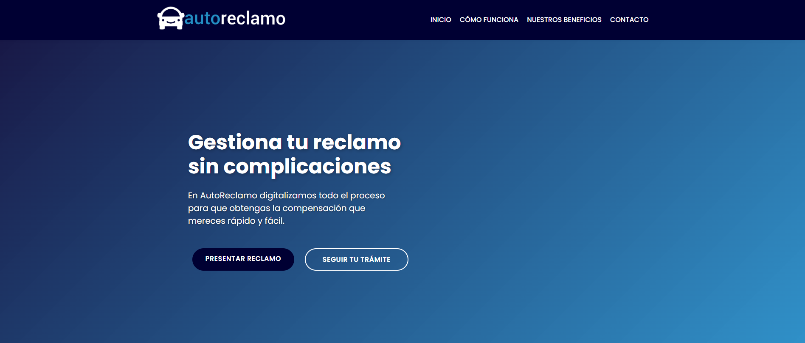
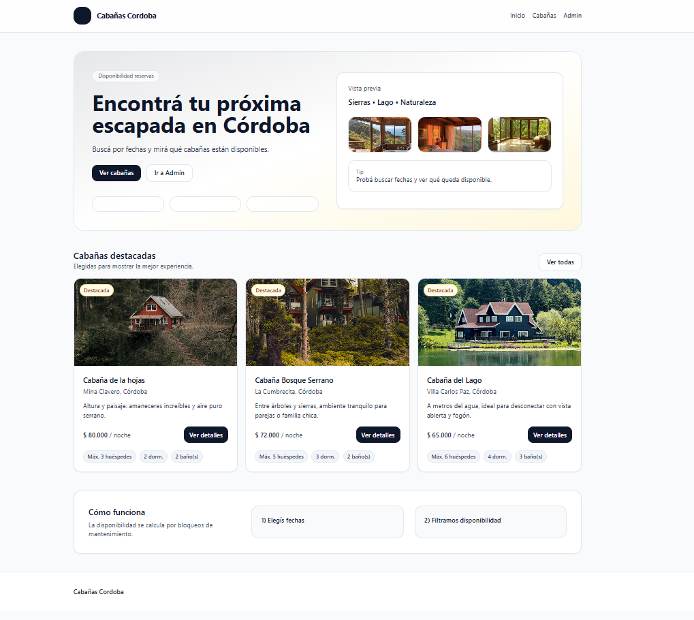

<div align="center">

# Charles Matias — Portafolio Profesional

### Full Stack Developer | React · TypeScript · Node.js · Next.js · SQL · Docker

**Portafolio personal para presentar mi experiencia, competencias técnicas y proyectos de desarrollo de software.**

[](https://charles-matias.vercel.app/)
[](https://www.linkedin.com/in/charlesmatias/)
[](https://github.com/CharlesMatiasOl)

</div>

---

## Descripción

Este proyecto es mi **portafolio profesional**, desarrollado para reunir en un solo lugar mi presentación, experiencia, tecnologías y trabajos destacados. Su objetivo es facilitar que reclutadores, equipos técnicos y potenciales colaboradores puedan conocer mi perfil y consultar ejemplos reales de mi trabajo.

La aplicación cuenta con una interfaz adaptable a distintos dispositivos, navegación por secciones, animaciones de interacción y un formulario de contacto. Está construida con **Next.js, React y TypeScript**.

Como Desarrollador Full Stack y Analista de Sistemas, mi experiencia abarca el desarrollo de aplicaciones web, APIs REST, bases de datos relacionales y soluciones orientadas a automatizar procesos y resolver necesidades de negocio.

## Características principales

- **Presentación profesional:** sección de inicio con acceso directo a proyectos, contacto, GitHub, LinkedIn y CV.
- **Sobre mí:** trayectoria, enfoque de trabajo, formación e intereses.
- **Competencias técnicas:** tecnologías organizadas por áreas de desarrollo.
- **Proyectos destacados:** tarjetas con descripción, stack, imágenes y enlaces a repositorios o demostraciones.
- **Contacto:** enlaces profesionales y formulario conectado con **Web3Forms**.
- **Diseño responsive:** interfaz preparada para dispositivos móviles y pantallas de escritorio.
- **Interacciones y animaciones:** transiciones y efectos de movimiento con Framer Motion.
- **Tema visual:** posibilidad de alternar entre modo claro y oscuro.
- **CV descargable:** acceso al documento PDF disponible en el sitio.

> Este repositorio corresponde al **frontend del portafolio**. Los proyectos mostrados pueden utilizar sus propios backends y bases de datos; el formulario de contacto se integra con un servicio externo.

---

## Tecnologías utilizadas en este portafolio

### Frontend


### Interfaz e integraciones


### Herramientas y despliegue


**Versiones declaradas en el proyecto:** Next.js 16, React 19, TypeScript 5 y Tailwind CSS 4.

---

## Estructura de la aplicación

```text
meu-portfolio/
├── app/
│   ├── globals.css        # Estilos globales
│   ├── layout.tsx         # Metadatos, tipografía y proveedor de tema
│   └── page.tsx           # Página principal
├── components/
│   ├── hero.tsx           # Presentación y acceso al CV
│   ├── about.tsx          # Sobre mí
│   ├── skills.tsx         # Tecnologías y herramientas
│   ├── projects.tsx       # Proyectos destacados
│   ├── contact.tsx        # Contacto y formulario
│   ├── nav.tsx            # Navegación responsive
│   ├── theme-provider.tsx # Contexto de temas
│   └── theme-toggle.tsx   # Selector claro/oscuro
├── public/                # Imágenes y CV en PDF
├── package.json
└── README.md
```

### Organización técnica

La página principal compone secciones reutilizables de React. **Next.js App Router** organiza la aplicación; **Tailwind CSS** proporciona estilos; **Framer Motion** gestiona animaciones; y **next-themes** permite alternar el tema visual. El formulario envía sus datos a la API pública de Web3Forms mediante una solicitud HTTP desde el navegador.

---

## Proyectos presentados

### AutoReclamo — Gestión de reclamos por siniestros automovilísticos

Plataforma Full Stack para digitalizar la presentación, el seguimiento y la administración de reclamos. Incluye formularios, estados, gestión de clientes y panel administrativo.

**Stack del proyecto:** JavaScript · Node.js · Express · MySQL · HTML · CSS · APIs REST

[Ver demostración](https://autoreclamo-frontend.vercel.app/) | [Ver código](https://github.com/CharlesMatiasOl/Proyecto-tesis-AutoReclamo-Local)



### Cabañas Córdoba — Catálogo y disponibilidad de alojamientos

Aplicación Full Stack para consultar cabañas, aplicar filtros, calcular estadías y administrar propiedades y bloqueos de mantenimiento. El cálculo de estadías no implica un pago o una reserva confirmada.

**Stack del proyecto:** Next.js · React · TypeScript · Tailwind CSS · Node.js · Express · MySQL

[Ver código](https://github.com/CharlesMatiasOl/cabanascordoba)



> Estos son los proyectos que aparecen actualmente en la sección de trabajos del portafolio. Otros proyectos se presentan en mi GitHub y LinkedIn.

---

## Ejecución local

### Requisitos

- Node.js compatible con Next.js 16 (20.9 o posterior).
- npm.
- Una clave pública de acceso de Web3Forms, **solamente si se desea utilizar el formulario de contacto**.

### 1. Clonar el repositorio

```bash
git clone https://github.com/CharlesMatiasOl/meu-portfolio.git
cd meu-portfolio
```

### 2. Instalar dependencias

```bash
npm ci
```

### 3. Configurar el formulario (opcional)

Crear un archivo `.env.local` en la raíz del proyecto:

```dotenv
NEXT_PUBLIC_WEB3FORMS_KEY=tu_clave_publica_de_web3forms
```

La aplicación puede mostrar el portafolio sin esta variable, pero el formulario de contacto no podrá enviar mensajes. La variable usa el prefijo `NEXT_PUBLIC_` porque es utilizada desde el navegador: **no colocar contraseñas ni secretos privados en variables públicas**. No publicar el archivo `.env.local`.

### 4. Ejecutar el servidor de desarrollo

```bash
npm run dev
```

Abrir [http://localhost:3000](http://localhost:3000).

### 5. Compilar y ejecutar para producción

```bash
npm run build
npm run start
```

Para comprobar el código con ESLint:

```bash
npm run lint
```

---

## Despliegue

El proyecto está preparado para su despliegue en **Vercel**, con integración directa para aplicaciones Next.js. El dominio del portafolio es:

**https://charles-matias.vercel.app/**

Al configurar un despliegue, la clave pública de Web3Forms debe añadirse como variable de entorno si se habilita el formulario.

---

## Autor y contacto

**Charles Matias de Oliveira**  
Analista de Sistemas · Desarrollador Full Stack  
Córdoba, Argentina

- [LinkedIn](https://www.linkedin.com/in/charlesmatias/)
- [GitHub](https://github.com/CharlesMatiasOl)
- [Portafolio](https://charles-matias.vercel.app/)
- [CV en PDF](public/CV-Charles-Matias.pdf)

---

<div align="center">

**Desarrollo de software orientado a resolver problemas reales.**

[](https://charles-matias.vercel.app/)

</div>
